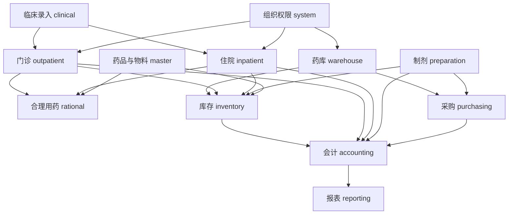

# 架构与目录设计

## 1. 技术方案

| 层次 | 方案 | 用途 |
| --- | --- | --- |
| 前端 | Vue 3 + TypeScript + Vite | 页面、类型检查、本地开发与构建 |
| 界面 | Element Plus + Lucide Vue | 表格、表单、弹窗、日期选择、图标 |
| 路由与状态 | Vue Router + Pinia | 权限导航、机构上下文、登录状态 |
| 请求与图表 | Axios + ECharts | REST 请求、消耗趋势、分类对比 |
| 后端 | Java 21 + Spring Boot 3.5.x + Maven | 单体业务应用；实施时锁定兼容补丁版本 |
| 持久化 | MyBatis-Plus Spring Boot 3 Starter | 基础 CRUD、分页和乐观锁；复杂账务查询用 Mapper SQL |
| 数据库 | MySQL 8.4 / InnoDB / utf8mb4 | 事务、并发锁、数据存储 |
| 安全 | Spring Security + Spring Session JDBC | 用户认证、数据库会话、动作权限、CSRF |
| 迁移 | Flyway Core + MySQL 模块 | 版本化 SQL；新建与升级数据库 |
| 校验与文档 | Jakarta Validation + springdoc-openapi | 入参校验、接口说明；实施时验证 Boot 兼容性 |
| 输出 | Apache POI + 前端打印样式 | Excel 报表、浏览器打印 |
| 测试 | JUnit 5、Spring Boot Test、Vitest、Playwright | 核心事务、界面和跨角色流程 |

第一版依赖数据库会话、定时任务和本地文件，不要求额外安装 Redis、消息队列或容器。依赖的具体小版本在开发开始时通过兼容验证并锁定。

## 2. 模块与依赖



模块关系表示业务调用，统一由业务服务组织事务，避免 Controller 直接操作多个 Mapper。库房、门诊、住院和制剂禁止自行更新库存表，统一调用 `InventoryPostingService`；所有财务凭证统一由 `AccountingPostingService` 生成和过账。

采购与价格是跨模块服务：物料和药品共用采购；价格模块维护全院药品零售价及生效版本。报表只读业务表和流水表，不能反向修改业务数据。复杂审批仍采用明确状态与审核记录，不引入通用流程引擎。

## 3. 后端分层

单个 Maven 工程，根包暂定 `com.hlsystem`。每个业务包保持 Controller、DTO、应用服务、业务规则、Mapper、Entity 的清晰职责。跨模块调用公开服务接口；同模块查询可直接使用本模块 Mapper。

| 层 | 职责 |
| --- | --- |
| Controller | 接收请求、校验、获取用户和机构上下文，返回统一响应 |
| DTO / VO | 入参与输出契约；避免数据库 Entity 直接暴露给客户端 |
| Application Service | 状态推进、权限与机构校验、事务、跨模块业务编排 |
| Policy / Calculator | 批次选择、价格、单位换算、剂量检查、成本规则 |
| Mapper / Entity | 持久化；分页与报表 SQL；不隐含业务审核逻辑 |
| Common | 异常、审计、金额类型、时间、分页等少量共用基础功能 |

库存执行、退款、付款、结账、价格生效设置事务边界。财务自动过账与业务提交在同一事务完成，失败全部回滚；手工报账模式在业务事务内生成待过账凭证，形成明确的待报账差异。

## 4. 规划目录

```text
hlsystem/
  docs/                             开发设计与验收材料
  front/
    package.json
    vite.config.ts
    src/
      main.ts
      App.vue
      api/                          HTTP 客户端和按模块接口
      router/                       路由定义、机构与权限守卫
      stores/                       auth、context、preferences
      layouts/                      MainLayout、PrintLayout
      components/
        common/                     PageHeader、DataTable、StatusTag
        business/                   DrugPicker、BatchPicker、AuditTimeline
      modules/
        workbench/                  工作台与预警
        system/                     用户、组织、角色、模板
        master/                     药品、物料、厂商、单位、字典
        clinical/                   患者、就诊、处方录入、医嘱、收费
        warehouse/                  采购、领药、药库作业
        outpatient/                 处方复核、发药、退药
        inpatient/                  医嘱确认、摆药、基数药
        inventory/                  库存、调拨、盘点、结账
        pricing/                    调价与历史
        accounting/                 对账、凭证、应付、付款
        preparation/                质检、配方、生产、成本
        rational/                   规则库、知识、审查结果
        reporting/                  统计与报表
      composables/                  查询条件、草稿恢复等实际复用逻辑
      types/                        共享接口类型
      utils/                        日期、金额显示、单位展示
      styles/                       设计变量、通用布局、打印样式
      assets/                       本地品牌与空状态素材
    tests/                          组件及关键流程测试
  back/
    pom.xml
    src/main/java/com/hlsystem/
      HlsystemApplication.java
      common/                       响应、异常、金额、审计与幂等
      config/                       安全、MyBatis、时间、调度
      security/                     登录、会话、授权、机构范围
      system/
      master/
      clinical/
      purchasing/
      warehouse/
      inventory/
      outpatient/
      inpatient/
      pricing/
      accounting/
      preparation/
      rational/
      reporting/
      integration/                  本地导入与外部数据接口约定
      各业务包内部：
        controller/
        dto/
        vo/
        service/
        policy/                     有复杂规则时才建立
        mapper/
        entity/
    src/main/resources/
      application.yml
      application-local.example.yml
      mapper/                       按模块组织 XML SQL
      db/migration/                 V001、V002 等结构与基础数据迁移
      db/demo/                      独立演示数据，非自动生产迁移
    src/test/java/com/hlsystem/
    runtime/                        本地附件，不提交 Git
```

上述是未来目录，不在规划阶段生成空壳文件。前端按业务模块放页面、页面专用组件和本模块类型；跨模块接口请求放 `api`。避免一次性建立过多通用封装。

## 5. 认证、安全与审计

- 登录用户名和 BCrypt 密码校验。会话使用 HttpOnly Cookie；上线 HTTPS 时启用 Secure，默认 SameSite=Lax。闲置会话超时 30 分钟。
- 本地 Vite 将 `/api` 代理到后端，浏览器同源访问；同源部署也使用 `/api`。保留 Spring Security CSRF 机制，前端携带 CSRF Token。
- 后端做动作级授权、机构范围及病区患者范围验证。前端隐藏按钮只是体验措施。
- 用户、药品、字典采用停用；事务单据执行后不可直接修改或删除。每次提交、审核、执行、放行、退款、调价和结账保存操作者、时间与原因。
- 附件只允许指定格式、大小和随机存储名，下载验证关联单据权限；不暴露磁盘路径。
- 接口日志脱敏患者身份号码、联系方式，禁止记录密码、Cookie 和完整处方请求体。业务审计与技术日志分别管理。
- Excel 导出按当前授权范围输出，文本防公式注入；打印模板只接受白名单字段与布局配置。

## 6. 部署与任务

本地默认：前端 `http://localhost:5173`，后端 `http://localhost:8080`，数据库主机与端口实施时确认。日期和业务日使用 `Asia/Shanghai`，服务与数据库连接时间设置一致。

本机启动顺序：建立数据库及最小权限账号 → 后端迁移 → 导入演示数据 → 启动后端 → 启动前端。未来可把 Vite 构建产物部署到静态服务器，再代理 `/api`。

定时任务包括效期预警、补货建议、长期医嘱执行实例生成、到期调价确认和待办聚合。所有任务有唯一业务键、执行记录和数据库锁；应用重启补跑不会重复过账。禁止定时任务直接自动结账或自动发药。

## 7. 工程质量

数据迁移按模块增量实现；正式迁移和演示数据分离。核心事务在 MySQL 8.4 上验证，不用 H2 代替锁行为测试。前后端维护格式、类型检查和构建检查，核心事务与角色流程有自动化验收。

报表先使用带索引的 SQL 聚合；分页默认 20、上限 100。大范围 Excel 输出限制行数并提示缩小时间段；后续确有需要再做异步导出。通过实际慢查询决定优化，不预先引入缓存或分库。
