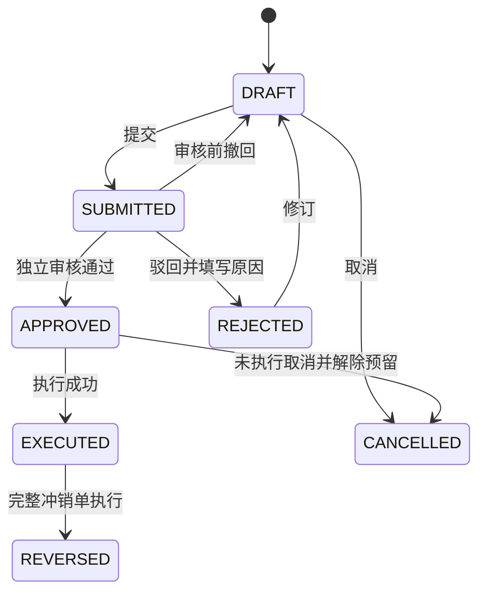
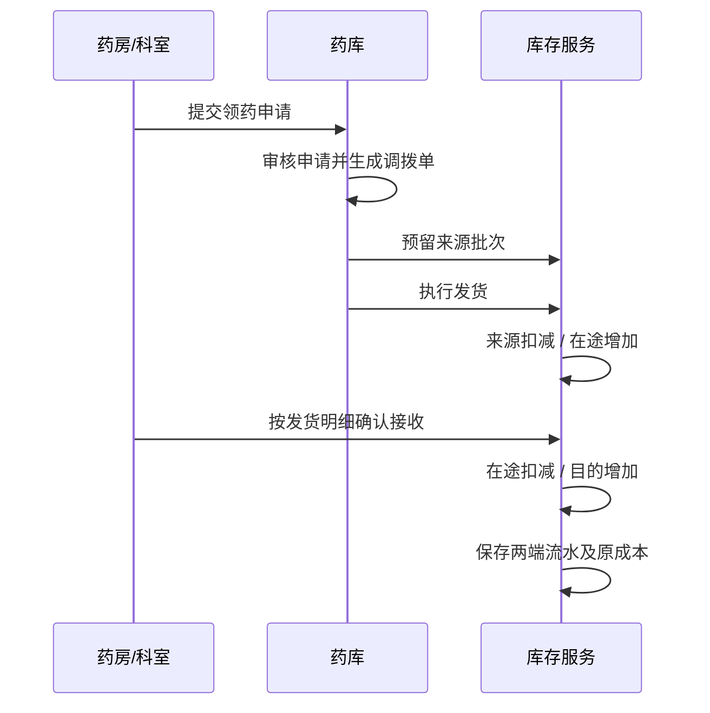

# 核心业务流程与计算规则

## 1. 通用单据状态



单据类型决定所需额外状态和操作权限。审核不修改库存，执行事务修改库存并保存流水及会计依据。执行失败保留已审核状态并给出原因，可以在问题解除后重试同一执行请求。

审核通过后的数量和价格被冻结。需要修改时先取消原单，再新建关联单。对已执行单据只允许受控的部分退回、退药或冲销；退回数量累计不能超过原执行数量。部分退回原单保持已执行，并显示累计退回数量，完整冲销才标记 `REVERSED`。

退回引用原单行和原批次，不接受客户端任意指定成本。结账期间内禁止冲销历史单，纠错单按当前开放期间记账并关联原单。

## 2. 库存模型

### 2.1 核算单位与批次成本

药品规格是独立药品记录。包装、发药、采购单位通过固定换算系数转换为最小库存单位。例如阿莫西林某规格：盒系数 24、片系数 1；入库 10 盒就是 240 片，发药 6 片剩余 234 片。

库存批次包含药品/物料、厂家、批号、生产与有效日期、质量状态。相同批号多次购入可能成本不同，建立不同成本层，不能用最新购进价覆盖旧货。发药先按效期，再按入库时间、成本层 ID 排序分配。

单位换算与价格快照随单据保存。已有业务的换算关系不能直接修改；包装变更建立新规格或新版本。片、支等不可拆分单位只接受整数；克、毫升等允许配置小数位。

### 2.2 库存数量

```text
可用库存 = 在手库存 - 有效预留数量
全院实物库存 = 各药库药房病区在手库存 + 调拨在途库存
期末库存 = 期初库存 + 本期入库数量 - 本期出库数量
```

预留是在手库存内的承诺数量，不额外计入全院库存。库存位置可为药库、门诊、住院、病区、制剂库或在途位置。每个位置与成本层再分可用、待检和隔离余额；同批次部分退回隔离时，不把剩余合格库存一起停用。只有批次质量合格、余额状态可用、未过期、未冻结且满足用途的数量可发出。

有效日期精确到日，标注有效期当天结束前有效，下一业务日起为过期；标签只给年月时需人工确认是否采用该月最后一日，并保存原标签。近效期阈值默认 90 天，可按机构与药品调整。未知效期不能直接成为可发药批次。

发药计划和调拨批准时分配批次并预留。预留失效时间可配置，取消、退款或超时解除；实际执行时重新检查效期、质量和可用量。库存不足时不自动换药或更改处方，返回不足明细。

执行步骤：验证登录与范围 → 校验幂等请求 → 按数据库设计的固定顺序锁定期间、价格、单据、账户、预留及库存 → 重新验证状态、数量与开放期间 → 更新数量和成本 → 写入不可变流水 → 更新临床费用或生成账务凭证 → 写操作轨迹 → 提交事务。

MySQL 行锁和带数量条件的更新保证不超卖；库存唯一键保证并发初始化不重复。需要重试死锁时重试整个事务，次数受限，所有业务唯一键继续生效。

### 2.3 成本金额

成本层按批次实际购入成本记录余额，具体剩余金额存于各位置的状态余额。部分出库成本按高精度单位成本计算后保留金额到分，最后一次清空该库存余额时取全部剩余成本，避免库存数量为零但残留几分钱。内部调拨继承实际出库成本，退回恢复原分配成本。

赠药购入成本为零，零售估值仍可按批准价格计算；实验药可限制使用地点和用途。报损、过期统计同时提供采购成本和零售估值，必须在列名中区分。

## 3. 采购与药库作业

### 3.1 采购计划

```text
日均消耗 = 最近 30 日实际使用/对外发药的净数量 ÷ 有效统计天数
目标库存 = max(配置的目标数量, 日均消耗 × (供货周期天数 + 安全天数))
采购建议 = max(0, 目标库存 - 合格可用库存 - 确定待到货数量)
```

内部调拨不算全院消耗。无消耗历史时使用人工设置的目标数量。待到货包含采购未到数量及已发出的入向调拨，排除取消数量；人工调整必须记录原因。建议按采购包装向上取整，展示剩余效期与可用数量，防止已有大量临近过期货时盲目补货。

计划审核后生成采购单。采购单允许分批到货，每次收货关联采购单行，累计到货不超过订单批准数量；超量需先变更订单。入库填写实际批号、有效期、数量、采购单价、厂家、供应商及质检。

普通药品审核验收后执行入库。制剂原料先入质量待检区域，合格后放行；待检库存不计可用数量。入库生成应付凭证，赠送入库不形成应付。退供引用原收货批次和成本，冲减库存与应付余额；已付款部分形成供应商待退款记录。

### 3.2 领药、调拨与接收



调拨扩展状态：`APPROVED → SHIPPED → PARTIALLY_RECEIVED → RECEIVED`。执行发货和接收是两个独立原子事务，在途始终可查询。接收可分次，累计接收不能超过发出数量。所有数量去向必须闭合后才结束单据。

接收短少不能直接确认原数量。剩余部分保留在途，通过经审核的退回来源或在途报损单处理。发货后不可普通取消；需要由接收/退回/报损完成闭环。

### 3.3 盘点、报损与退药

盘点先锁定所选机构和物料范围，禁止该范围库存执行，保存账面批次快照；录入实盘数量，生成差异单，审核后才过账并解除锁定。取消盘点解除锁。第一版采用范围冻结，避免边盘边动的计算复杂性。

报损和丢失填写原因、责任说明、批次、数量及附件。盘盈必须说明批号和成本来源；无法证明质量和来源时放入隔离状态，不允许直接发药。

患者退药先由药师审核原发药与包装、效期、质量。可再次使用的回原批次及成本层，不可再次使用的进入隔离库存，再通过报废单扣减。退药确认产生退款资格；退款作为独立操作完成，不能假设已自动退钱。

## 4. 门诊处方与收费


处方状态：`DRAFT、SUBMITTED、REJECTED、PRICED、PAID、VERIFIED、DISPENSED、CANCELLED`。退药和退款状态分开显示，不用一个状态掩盖部分退药。

处方价格由当前生效零售价及单位换算生成，行金额按实际发药数量计算。售价均为含税演示金额，第一版不计算税额拆分。日处方量默认按成功发药处方统计，可切换开方量与缴费量，按普通、急诊、中药、控制药等分类展示。

划价后保留价格快照和可配置的付款期限。未缴费超时释放预留，重新划价采用当前价格；已缴费不能因预留过期自动退款，需重新分配批次或办理退款。发药不支持默默部分执行；第一版要求整张处方有足够库存，否则经医生修订或撤销重新录入。

普通药品须有独立复核人与发药人；毒麻精神药须记录领药人、有效证件摘要、用途和数量，由具备特殊权限的独立药师复核。其登记记录与发药同步保存，不出现有出库无登记。

缴费可多笔记录但累计不能超过应收；全部支付后才进入已缴费。部分缴费也可取消并按已收金额退款。发药前取消不产生库存退回，发药后退款须先有退药或特殊核准的非退货退款原因。

## 5. 住院医嘱、摆药与基数药

住院登记包含病区、床位、医生、诊断和押金账户。医嘱类型为临时、长期及中草药处方，记录给药途径、单次剂量、频次、起止时间、执行日期规则。隔日医嘱使用起始日期作为锚点，按自然日间隔计算；特殊医嘱支持明确的执行日期和时段列表。

长期医嘱按时间段生成执行实例，唯一键为“医嘱行 + 计划执行时间”。实例状态为待确认、已确认、已摆药、已发药、已取消。停嘱只取消尚未执行的未来实例；已经发出的走退药，不删除历史。

确认上账：锁定押金账户 → 检查医嘱有效性与用药审查 → 计算数量和价格快照 → 生成费用及押金占用/扣费流水 → 预留库存。欠费默认阻断，有权限账号填写理由后放行并记录负余额。后续取消未发执行单冲回费用并解除预留。

摆药按针剂、片剂、输液、毒麻、中草药及其他分类，支持患者明细摆药单与按病区/药品汇总的统领单。生成摆药单只是编组，不重复扣库存和扣费。药师确认发药才完成库存出库，执行单与费用一一关联。

调度重复执行不会重复生成、扣费、摆药或发药。摆药后停嘱提示人工处理，不能继续发药。实际给药执行可简化为病区登记，记录执行人、时间与未执行原因。

病区基数药使用真实病区库存位置。补充为内部调拨，领到病区不算全院消耗；病区实际使用产生出库流水。关联患者的使用生成患者费用，非患者用途需注明类别。基数药库存与药房摆药发出的患者药物分开记录，避免重复消耗。

## 6. 价格与会计核算

### 6.1 调价

价格策略记录采购折扣率、零售加成率及计算基准；初始支持 `采购价 = 基准价 × 折扣率`，`建议零售价 = 参考购进价 × (1 + 加成率)`，以批准文件或手工确认价为实际生效价。同药不同批次购进价不强制一致。

调价单包含原价、新价、原因、文件编号和附件、生效时间、确认模式。手动模式须会计确认；自动模式仍须预先由独立人员批准调价单，定时任务到生效时间幂等执行。不是未经审核自动修改价格。

全院价同时生效。执行锁定涉及的药品价格行并递增价格版本；库存操作也先锁对应价格行，保证生效切点的库存估值一致。调价明细按机构、批次、在途记录生效时实际在手数量。预留在手数量已计入，不能再次累加。

```text
调价估值差额 = 生效时库存基础数量 × (新基础零售价 - 旧基础零售价)
```

差额表示零售估值变化，采购成本不改变；使用独立估值调整台账和凭证类别。历史处方和医嘱已确认价格不回写。调价后旧价交易仍按快照发药，对账采用实际交易价。

### 6.2 会计口径

| 指标 | 定义 |
| --- | --- |
| 购入成本 | 本期外部采购实际入库成本减退供成本；内部调拨排除 |
| 期末库存成本 | 各实际位置和在途成本层剩余金额合计 |
| 期末零售估值 | 各批次在手数量乘当前零售价；材料不强行套药品售价 |
| 消耗成本 | 对外发药、病区实际使用、报损等出库成本，按业务分类分别列出 |
| 发药销售净额 | 已发药实际金额减已确认患者退药对应金额 |
| 净收款 | 实际缴费减实际退款；住院押金到账单独列示 |
| 月实际综合加成率 | `(发药销售净额 - 对应净发药成本) / 对应净发药成本 × 100%`；分母为零显示不适用 |
| 周转天数 | 平均库存成本 / 日均净发药成本；期间和分母在报表展示 |

住院费用确认早于发药，门诊收款也可能早于发药。因此对账使用源处方/执行单/退药单匹配，并单独展示已缴未发、已记账未发、退药待退款、发药欠费和待财务过账，不直接用当日两笔汇总强行相等。

凭证采用简化借贷模型：采购借库存贷应付；调拨借目的库存贷来源库存；发药借消耗成本贷库存，并记录收入/预收结转；报损借损失贷库存；付款借应付贷资金。住院押金和门诊已收未发记预收，发药时结转收入，欠费部分记应收。每个源事件只产生一次对应凭证。

制剂原料投入在制品，产出转半成品/成品，领料本身不直接重复确认为销售成本。内部调拨不形成全院收入。

### 6.3 结账

日结生成位置与批次快照及平衡报告，已日结的日期不接受补记业务，纠错在开放日期完成。月结要求当月日结完成、所有需过账凭证完成、差异处理完毕；未结束调拨允许保留在途，但须在期末账表中明确列示。年结基于十二个月结。

业务只能记当前开放业务日，执行时间不允许客户端任意回填。执行和结账共同锁定期间控制行，避免检查后另一个事务关闭期间。重开需会计专门权限、原因和审计，已被上级月结/年结引用的期间必须先解除上级结账，重新结账标记旧快照失效并保存版本。

## 7. 制剂生产与质检


配方与工序采用版本化，生产订单固定使用某一批准版本，后续配方编辑不影响进行中的订单。半成品可作为后续生产的投入物，必须先有合格批次和确定成本。

质检分原料入库检查、外用/内服卫生学检验、成品检验，保存项目、标准、实测值、结论、检测人、复核人和日期。不合格批次隔离，可经批准返工或报废；返工关联原订单，保留原质量记录。药品外部购入通过验收登记质量，制剂自产必须有合格质检。

```text
订单实际成本 = 实际净领料成本 + 人工费用 + 水电气费用 + 其他批准费用
材料用量差异 = 实际净领料数量 - 按实际产量计算的标准用量
合格产品单位成本 = 批准分摊到合格产品的成本 ÷ 合格产出基础数量
```

未耗用领料退回原批次并冲回在制成本。正常损耗计入合格产品成本，异常损失单独转损失费用。第一版每个生产订单只生产一个目标产品，支持分批产出。结算前产出只记生产待入库数量，成本仍在在制品账户，不写入可发出的成品库存；成本结算后统一建立成本层和入库流水，才能出售或向药库调拨。最后一批承接金额舍入尾差。

工时、产量、水电气定额以配方/工序版本保存，实际值可录入并比较。成本结算与产出入库在一个事务中完成，同一生产订单不能重复结算。

## 8. 合理用药检查

检查输入包括患者出生日期、体重、过敏史、诊断、处方/医嘱药品、成分、单次剂量、频次、途径及同一患者当前有效用药。处方之间也可检查重叠时间段，避免只检测单张处方。

| 检查项 | 匹配对象 | 处理 |
| --- | --- | --- |
| 过敏 | 药品、成分、药物分类 | 严重阻断；缺过敏史标记资料未确认 |
| 相互作用 | 规范化药品对或成分对 | 按配置严重度阻断或警告 |
| 剂量 | 单次、日剂量、年龄、体重、给药途径 | 单位换算后比较；不可换算则提示无法判定 |
| 禁忌症 | 诊断、年龄、妊娠等已记录属性 | 严重禁忌阻断 |
| 适应症 | 诊断编码与药品适应症 | 未匹配提示人工确认，不强判禁用 |
| 重复用药 | 相同药品、成分重复和组合药成分 | 提示叠加剂量和来源 |

结构化规则使用类型、目标、条件、阈值和严重度，不支持任意脚本执行。每次检查记录规则版本、输入摘要、命中项和结论。普通警告需要药师逐项说明理由；严重命中须修正处方或规则后重查，不能通过普通放行继续。

资料不足的检查显示“无法判断”，不能显示“通过”。审查后修改处方、医嘱、诊断或过敏资料使旧审查失效，重新审核；规则升级或新增停用风险在实际发药前再校验。知识库保存来源、版本、审核状态与示例标记，批准后才参与自动审查。
