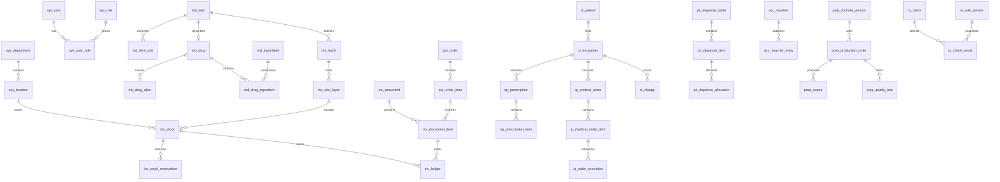

# 数据库设计

## 1. 基础规范

数据库名 `hlsystem`，MySQL 8.4，InnoDB，字符集 `utf8mb4`，排序规则 `utf8mb4_0900_ai_ci`。本文件是逻辑及字段设计，建表 SQL 在开发阶段随模块迁移编写。

| 项目 | 约定 |
| --- | --- |
| 主键 | `id BIGINT`，MyBatis-Plus 雪花 ID；JSON 输出为字符串 |
| 通用业务字段 | `created_at DATETIME(3)`、`updated_at DATETIME(3)`、`created_by BIGINT`、`updated_by BIGINT`、`version INT` |
| 机构 | 所属业务机构存 `location_id` 或 `department_id`；通过外键与后端范围验证 |
| 日期 | 效期 `DATE`；执行与审计 `DATETIME(3)`；业务日期 `business_date DATE` |
| 数量 | `DECIMAL(18,6)`；按物料可拆分与精度规则验证 |
| 基础单位单价 | `DECIMAL(18,6)`；表示每一最小库存单位金额 |
| 已确认金额 | `DECIMAL(18,2)`；人民币，后端 BigDecimal，HALF_UP 到分 |
| 换算系数 | `DECIMAL(18,6)` 且大于零；换算前后数量分别保存 |
| 比率 | `DECIMAL(12,6)`，如加成 15% 存 0.15 |
| 业务状态 | `VARCHAR(32)`，明确允许值；迁移约束与服务状态机双重控制 |
| 编码和编号 | 通常 `VARCHAR(64)`；物料编码、单据编号分别唯一 |
| 名称和说明 | 名称 `VARCHAR(200)`，原因 `VARCHAR(500)`，长说明 `TEXT` |
| JSON | 只存规则条件、模板布局、审查输入快照；库存和账务不放 JSON |
| 停用 | 字典和基础资料使用 `enabled`，已引用资料不可删除 |
| 不可变记录 | 流水、审查命中、执行记录和已过账凭证只追加；更正通过反向事件 |

不可变流水可省略 `updated_*` 和 `version`。纯关联表只保留必要字段。FK 采用 RESTRICT，不级联删除业务历史。用户名、代码等规范化字段另存小写/去空白键；药品别名可重复，搜索结果返回候选，不能把有歧义别名设成唯一规范名。

审计与业务源引用的 `source_type + source_id` 是明确的白名单类型组合，由服务验证存在性，不做伪装外键；具体患者、药品、库房、批次和单据行使用真实 FK。业务编号通过数据库唯一序列生成，不使用 `count + 1`。

## 2. 主要实体关系



`md_item` 是药品、原料、包装、半成品的统一库存对象，`md_drug` 是药品扩展信息。制剂成品需要医院发药时必须有 `md_drug` 扩展。这样库存、单位与成本使用同一套规则。

## 3. 表与关键字段

以下各表默认包含主键与适用的通用字段。表中的关联 ID 必须有外键或明确的源事件校验。字段列是核心字段集合，实施时补充非空、默认值、约束及适用说明。

### 3.1 组织、权限与基础运行

| 表 | 关键字段 | 约束及用途 |
| --- | --- | --- |
| `sys_hospital` | code、name、address、contact | 单院配置，code 唯一 |
| `sys_department` | hospital_id、parent_id、code、name、type、enabled | 父子科室；病区也是部门类型，禁止层级循环 |
| `sys_location` | department_id、code、name、type、enabled | WAREHOUSE/OUTPATIENT/INPATIENT/WARD/PREPARATION/TRANSIT；机构 code 唯一 |
| `sys_user` | username、password_hash、display_name、department_id、enabled | username 唯一；医生是具有医生角色的账号 |
| `sys_role` | code、name、enabled | 七种初始角色，code 唯一 |
| `sys_permission` | code、name、module、action | 动作编码唯一 |
| `sys_user_role` | user_id、role_id | unique(user_id, role_id) |
| `sys_role_permission` | role_id、permission_id | unique(role_id, permission_id) |
| `sys_user_scope` | user_id、scope_type、scope_id | 明确 LOCATION/DEPARTMENT；unique 三列；验证 scope 对象 |
| `sys_dict_type` | code、name | 医保类别、剂型、频次等字典类，code 唯一 |
| `sys_dict_entry` | type_id、code、label、sort_order、enabled | unique(type_id, code) |
| `sys_config` | key、value、value_type、description | 超时、报警天数等，key 唯一，敏感值不放这里 |
| `sys_print_template` | document_type、name、layout_json、revision、enabled | 版本化白名单模板，签字栏不可移除 |
| `sys_attachment` | storage_key、original_name、mime_type、size、source_type、source_id | 权限下载；随机存储 key 唯一 |
| `sys_audit_log` | user_id、action、source_type、source_id、before_summary、after_summary、reason、occurred_at | 追加，不存密码和完整患者隐私 |
| `sys_document_action` | source_type、source_id、from_status、to_status、action、operator_id、reason、occurred_at | 业务审核和执行轨迹 |
| `sys_idempotency` | user_id、route_key、request_key、request_hash、status、result_ref、expires_at | unique(user_id, route_key, request_key) |
| `sys_job_run` | job_type、business_key、status、started_at、finished_at、error_summary | unique(job_type, business_key)，调度重试可追踪 |
| `sys_number_sequence` | document_type、business_date、next_value | unique(document_type, business_date)，锁行生成编号 |

Spring Session JDBC 所需 `SPRING_SESSION`、`SPRING_SESSION_ATTRIBUTES` 使用框架匹配的 MySQL 迁移模板，独立于上述业务表。框架 DDL 也纳入版本化迁移。

### 3.2 药品、物料与价格基础资料

| 表 | 关键字段 | 约束及用途 |
| --- | --- | --- |
| `md_unit` | code、name、dimension、canonical_unit_id、factor_to_canonical | 单位 code 唯一；同维度剂量可规范化，如 g 转 mg；盒到片仍走物料专用换算 |
| `md_frequency` | code、name、interval_days、administrations_per_day、time_slots_json、requires_explicit_schedule、enabled | 频次结构化，支持每日多次、隔日和明确日期；按需用药不自动推断日剂量 |
| `md_manufacturer` | code、name、country、contact、enabled | 厂家 |
| `md_supplier` | code、name、contact、license_no、enabled | 供货商及资质 |
| `md_item` | code、name、specification、item_type、base_unit_id、quantity_scale、splittable、enabled | code 唯一；药品/原料/辅料/包装/半成品/成品 |
| `md_item_unit` | item_id、unit_id、factor_to_base、purpose、enabled | 相同物料/单位/用途唯一；purpose 为采购/包装/发药等 |
| `md_drug` | item_id、generic_name、trade_name、manufacturer_id、dosage_form_code、category_code、insurance_code、insurance_category、prescription_required、control_level、imported、in_house、self_pay、valuable、price_version | item_id 唯一；控制级别独立于其他可并存标志 |
| `md_drug_alias` | drug_id、alias、normalized_alias、alias_type | unique(drug_id, normalized_alias)，允许不同药品同别名 |
| `md_ingredient` | code、name、classification_code | 成分 code 唯一；分类用于过敏识别 |
| `md_drug_ingredient` | drug_id、ingredient_id、strength_amount、strength_unit_id、per_base_quantity | unique(drug_id, ingredient_id)，剂量单位与库存单位分开 |
| `md_supplier_item` | supplier_id、item_id、purchase_unit_id、quoted_price、lead_days、enabled | 报价历史保留版本，计算建议供应商 |
| `md_location_item` | location_id、item_id、min_qty、target_qty、max_qty、expiry_warn_days、restricted_use、enabled | unique(location_id, item_id)；药房目录及库存阈值 |
| `md_diagnosis` | code、name、enabled | 诊断编码唯一，规则采用结构化编码 |
| `price_policy` | drug_id、reference_price、discount_rate、markup_rate、effective_from、effective_to、approved_by | 版本化价格参数，时间范围不能重叠 |
| `price_history` | drug_id、base_retail_price、effective_from、effective_to、revision、adjustment_id | 同药版本唯一；每时点只有一个生效价格 |

药品进口、自费、院内、贵重可同时为真，不用互斥枚举掩盖。控制等级为 NORMAL、TOXIC、NARCOTIC、PSYCHOTROPIC 等明确值，可根据演示字典细分精神药等级。

### 3.3 采购、库存与结算

| 表 | 关键字段 | 约束及用途 |
| --- | --- | --- |
| `pur_plan` | number、location_id、plan_type、basis_from、basis_to、status、reason | 药品及制剂物料共用计划 |
| `pur_plan_item` | plan_id、item_id、suggested_base_qty、approved_qty、unit_id、factor_snapshot、supplier_id | 保存建议依据快照 |
| `pur_order` | number、plan_id、supplier_id、receiving_location_id、status、expected_date | 单一供货商，可分次到货 |
| `pur_order_item` | order_id、plan_item_id、item_id、quantity、unit_id、factor_snapshot、base_qty、unit_price、amount、received_base_qty、cancelled_base_qty | 到货数量由执行事务累计 |
| `inv_batch` | item_id、manufacturer_id、batch_no、manufactured_on、expires_on、quality_status、special_source、production_order_id | 厂家非空，院内制剂用医院厂家；unique(item_id, manufacturer_id, batch_no)；日期冲突禁止合并 |
| `inv_cost_layer` | batch_id、receipt_document_item_id、layer_key、base_unit_cost、original_qty、original_cost、currency | layer_key 唯一；同批不同购价独立成本层，币种固定 CNY |
| `inv_stock` | location_id、cost_layer_id、stock_status、on_hand_qty、reserved_qty、remaining_cost、frozen | unique(location_id, cost_layer_id, stock_status)；AVAILABLE/PENDING_QC/QUARANTINE；数量和成本非负，reserved <= on_hand |
| `inv_document` | number、type、location_id、source_location_id、target_location_id、supplier_id、status、business_date、source_type、source_id、reversal_of_id、reason | 类型包括入库、调拨、报损、退供、退药、生产投入产出、盘点差异等 |
| `inv_document_item` | document_id、item_id、batch_id、cost_layer_id、stock_id、unit_id、quantity、factor_snapshot、base_qty、cost_amount、retail_price_snapshot、purchase_order_item_id、original_item_id、direction | 出库必须指向成本层；入库可先无层，执行时建立 |
| `inv_stock_reservation` | stock_id、source_type、source_id、source_line_id、base_qty、status、expires_at | 幂等分配键；ACTIVE/CONSUMED/RELEASED，已消费不得重开 |
| `inv_ledger` | stock_id、document_item_id、event_key、business_date、occurred_at、qty_delta、cost_delta、balance_qty、balance_cost、operator_id、reversal_of_id | event_key 唯一；每个单据执行腿一条，正负方向明确 |
| `inv_transfer_receipt` | transfer_document_id、number、status、received_at、operator_id | 每次调拨接收独立记录 |
| `inv_transfer_receipt_item` | receipt_id、shipment_document_item_id、receipt_document_item_id、received_base_qty | 分次接收与在途出库追溯 |
| `inv_transfer_balance` | shipment_document_item_id、transit_stock_id、shipped_base_qty、remaining_base_qty、remaining_cost、received_base_qty、returned_base_qty、lost_base_qty | 发货行唯一；锁行维护在途归属和成本，接收不能挪用其他调拨在途 |
| `inv_requisition` | number、request_location_id、supply_location_id、department_id、status、needed_on、source_type | 药房及科室自动进入供货机构待办 |
| `inv_requisition_item` | requisition_id、item_id、requested_qty、unit_id、factor_snapshot、approved_base_qty、fulfilled_base_qty | 不超过批准累计供应 |
| `inv_transfer_requisition` | transfer_document_id、requisition_item_id、allocated_base_qty | 汇总多个申请生成调拨；供应累计可追溯 |
| `inv_stocktake` | number、location_id、status、started_at、finished_at、difference_document_id | 盘点范围冻结 |
| `inv_stocktake_item` | stocktake_id、stock_id、snapshot_qty、snapshot_cost、counted_qty、difference_qty、reason | unique(stocktake_id, stock_id)；新发现批次另建登记行 |
| `inv_scope_lock` | location_id、item_id、stocktake_id、status | unique(location_id, item_id)；所有执行操作共同校验锁 |
| `inv_alert` | location_id、item_id、batch_id、type、rule_key、observed_qty、cost_amount、retail_amount、status、first_seen_at、last_seen_at | 按业务键更新同一活跃预警；低库存/近效期/过期 |
| `inv_control_register` | document_item_id、patient_id、recipient_name、identity_summary、purpose、quantity、reviewer_id、executor_id | 控制药发出与退回登记，独立人员约束 |
| `inv_closing` | location_id、period_type、period_start、period_end、revision、status、closed_by、closed_at、reopened_reason | 同位置同期间仅一个有效结账版本 |
| `inv_closing_item` | closing_id、stock_id、opening_qty、in_qty、out_qty、closing_qty、opening_cost、in_cost、out_cost、closing_cost、retail_value | unique(closing_id, stock_id)，核对快照与流水 |

在途设一个系统库存位置，每条调拨流水明确来源和目的。在途库存通过 `inv_transfer_balance` 归属到具体发货行，不将所有在途成本混为无法分配的余额。接收取对应发货行尚未接收数量与成本，最后接收部分承接舍入尾差；余额子账合计必须与系统在途库存一致。

隔离退药与原合格库存使用同成本层、不同 `stock_status`。质量放行或隔离迁移写一出一入的状态变更流水，全院数量与成本不变；对整个批次发现质量问题时可以将 `inv_batch.quality_status` 改为禁用，所有库存立即停止使用。入库待检物料计实际库存及成本，但可用量为零。

新盘盈批次：`inv_stocktake_item.stock_id` 可空，但必须补充 item、batch、拟定成本字段，审核后经差异单建立成本层；正常盘点行必须有 stock_id。同一物料范围冻结后，该物料所有批次都不得变动。

### 3.4 临床、处方、医嘱、费用与发药

| 表 | 关键字段 | 约束及用途 |
| --- | --- | --- |
| `cl_patient` | patient_no、name、sex、birth_date、identity_summary、phone、pregnancy_status、allergy_confirmed_at | 患者编号唯一，演示使用虚构资料 |
| `cl_patient_measurement` | patient_id、encounter_id、measurement_type、value、unit_id、measured_at、operator_id | 体重等测量；剂量审查保存所选测量 ID 与值，过期/缺失体重不能假定正常 |
| `cl_patient_allergy` | patient_id、target_type、drug_id、ingredient_id、classification_code、reaction、severity、confirmed_by | 目标类型决定一个有效目标；保存过敏史 |
| `cl_encounter` | number、patient_id、type、department_id、doctor_id、admitted_at、discharged_at、ward_id、bed_no、status | 门诊/住院就诊记录；住院病区与床位历史另存转科事件 |
| `cl_encounter_diagnosis` | encounter_id、diagnosis_id、is_primary、recorded_at | 同一就诊诊断唯一 |
| `cl_encounter_event` | encounter_id、type、from_department_id、to_department_id、from_bed、to_bed、occurred_at、operator_id | 入院、转科、出院历史，不覆盖历史发药科室 |
| `cl_charge` | encounter_id、source_type、source_id、source_line_id、charge_kind、amount、remaining_refundable_amount、status、price_snapshot、original_charge_id | 应收费用及冲回；同源收费事件唯一 |
| `cl_payment` | number、encounter_id、kind、amount、method、paid_at、operator_id、original_payment_id、status | 门诊收费/退款、住院押金/退押金；金额大于零，用 kind 表示方向 |
| `cl_payment_allocation` | payment_id、charge_id、allocated_amount、original_allocation_id | 门诊缴费和退款匹配费用，退款额度锁行校验 |
| `cl_deposit_account` | encounter_id、deposited_amount、charged_amount、refund_amount、balance | 住院 encounter_id 唯一，余额允许授权负值 |
| `cl_deposit_ledger` | account_id、event_key、payment_id、charge_id、delta、balance_after、reason、operator_id | event_key 唯一，余额由完整流水核对 |
| `op_prescription` | number、encounter_id、doctor_id、pharmacy_id、prescription_type、status、total_amount、pricing_expires_at、current_check_id、verified_by、dispensed_by | 费用及批次分配在审核后冻结；双人执行 |
| `op_prescription_item` | prescription_id、drug_id、dose_amount、dose_unit_id、frequency_code、route_code、days、quantity、dispense_unit_id、factor_snapshot、base_qty、unit_price_snapshot、amount、directions | 剂量与发药数量分开；后端计算日剂量 |
| `ip_medical_order` | number、encounter_id、doctor_id、order_type、status、start_at、stop_at、current_check_id | 临时/长期/中草药，停止后保留 |
| `ip_medical_order_item` | order_id、drug_id、dose_amount、dose_unit_id、frequency_code、route_code、schedule_json、base_qty_per_execution、executing_location_id、start_at、end_at | 执行计划是白名单结构；可指定门诊药房执行 |
| `ip_order_execution` | order_item_id、scheduled_at、business_date、status、confirmed_by、charge_id、base_qty、price_snapshot、amount、shortfall_override_reason | unique(order_item_id, scheduled_at)；确认费用唯一 |
| `ph_dispense_order` | number、type、location_id、prescription_id、picking_list_id、status、verified_by、executed_by、executed_at、recipient_snapshot | 门诊/住院统一发药单，可关联一张处方或摆药组 |
| `ph_dispense_item` | dispense_order_id、prescription_item_id、order_execution_id、drug_id、base_qty、charge_id | 门诊行/住院实例恰好一个源，FK 与 CHECK 验证 |
| `ph_dispense_allocation` | dispense_item_id、stock_id、reservation_id、document_item_id、base_qty、cost_amount、retail_amount | 发药与批次一对多，发药后成本快照不可变 |
| `ph_return_order` | number、dispense_order_id、encounter_id、location_id、status、reason、refund_status | 退药与退款分别推进 |
| `ph_return_item` | return_order_id、allocation_id、base_qty、cost_amount、retail_amount、quality_disposition、inventory_document_item_id、reversal_charge_id | 累计退量不超原批次分配；合格回库或隔离 |
| `ip_picking_list` | number、location_id、ward_id、type、period_start、period_end、status | 针剂/片剂/输液/毒麻/中草药/其他 |
| `ip_picking_list_item` | picking_list_id、execution_id、patient_snapshot、department_snapshot、base_qty | 一个活跃实例只能属于一个有效摆药单 |
| `ip_ward_quota` | ward_location_id、item_id、quota_qty、min_qty、enabled | unique(ward_location_id, item_id)，病区基数药 |
| `ip_ward_usage` | ward_location_id、item_id、encounter_id、document_id、charge_id、base_qty、purpose、used_at、operator_id | 患者使用有费用；非患者使用须填写用途 |

`cl_charge` 记录确认金额和原价格，不直接以余额判断已发药。缴费状态由付款分配汇总，住院余额由独立账户计算。收费调整建立反向费用，退药退款建立付款反向事件，禁止直接减原金额。

### 3.5 会计、调价与付款

| 表 | 关键字段 | 约束及用途 |
| --- | --- | --- |
| `price_adjustment` | number、reason、reference_file_no、effective_at、confirmation_mode、status、approved_by、confirmed_at | 全院调价；自动执行前须批准 |
| `price_adjustment_item` | adjustment_id、drug_id、old_price、new_price、old_revision、new_revision | unique(adjustment_id, drug_id) |
| `price_valuation_detail` | adjustment_item_id、stock_id、quantity_snapshot、old_value、new_value、difference | unique(adjustment_item_id, stock_id)，调价估值依据 |
| `acc_account` | code、name、type、enabled | 库存、在制、收入、预收、应收、应付、成本、损失、资金及估值科目 |
| `acc_voucher` | number、business_date、source_type、source_id、event_key、status、posting_mode、posted_by、posted_at、reversal_of_id | event_key 唯一，未过账仅草稿可编辑 |
| `acc_voucher_entry` | voucher_id、line_no、account_id、location_id、department_id、debit、credit、currency、description | unique(voucher_id, line_no)，借贷一侧为正另一侧为零 |
| `acc_payable` | supplier_id、source_document_id、amount、adjustment_amount、paid_amount、status | 收货及退供匹配应付；供应商退款有独立负向事件 |
| `acc_supplier_payment` | number、supplier_id、kind、amount、method、status、paid_at、operator_id | 供应商付款/退款，独立审核执行 |
| `acc_supplier_payment_item` | payment_id、payable_id、allocated_amount | 支付锁应付余额；退供已付款形成待退款余额 |
| `acc_reconciliation` | number、type、location_id、period_start、period_end、status、difference_amount、resolved_by | 收费发药/库存账/财务账对账 |
| `acc_reconciliation_item` | reconciliation_id、source_type、source_id、expected_amount、actual_amount、difference_type、resolution、status | 已收未发、退药待退款、欠费、待过账等 |
| `acc_period` | period_type、period_start、period_end、status、revision、closed_by、closed_at | unique(type, start, end)，执行与关账共同加锁 |

零售估值调整台账与采购成本科目分开：`price_valuation_detail` 为估值明细，对应估值类凭证不改变 `inv_stock.remaining_cost`。

### 3.6 制剂配方、生产与质检

| 表 | 关键字段 | 约束及用途 |
| --- | --- | --- |
| `prep_formula` | code、name、output_item_id、enabled | 一种配方对应一个目标产品，code 唯一 |
| `prep_formula_version` | formula_id、revision、standard_output_qty、output_unit_id、status、approved_by、approved_at | unique(formula_id, revision)，批准后不可改 |
| `prep_formula_item` | formula_version_id、input_item_id、standard_base_qty、loss_rate | 原辅料、包装及合格半成品投入 |
| `prep_process_standard` | formula_version_id、step_no、name、standard_hours、standard_yield、water_qty、electricity_qty、gas_qty、instructions | 工序与定额绑定版本 |
| `prep_production_order` | number、formula_version_id、location_id、planned_base_qty、batch_no、status、started_at、finished_at、cost_settled_at | 生产批次和版本固定 |
| `prep_material_issue` | production_order_id、inventory_document_id、kind、status | 领料/退料原子库存单，投入与原批次可追溯 |
| `prep_process_record` | production_order_id、standard_step_id、actual_hours、actual_yield、water_qty、electricity_qty、gas_qty、operator_id、started_at、finished_at | 工序执行、实际定额 |
| `prep_quality_test` | number、test_type、batch_id、production_order_id、status、conclusion、tested_by、reviewed_by、tested_at | 原料/内服卫生/外用卫生/成品检测；审检独立 |
| `prep_quality_test_item` | quality_test_id、test_name、standard_description、measured_value、unit_id、passed | 明细检验项目 |
| `prep_output` | production_order_id、batch_id、base_qty、quality_test_id、inventory_document_id、status、allocated_cost | 分批产出，待检/待成本/已入库；成本结算前 inventory_document_id 为空，非零成本只在结算后确定 |
| `prep_cost_entry` | production_order_id、type、source_document_item_id、amount、quantity、unit_rate、reason | 材料由库存自动生成，人工/能源/其他由记录批准生成 |
| `prep_cost_settlement` | production_order_id、material_cost、labor_cost、energy_cost、other_cost、abnormal_loss_cost、good_output_qty、unit_cost、voucher_id、settled_by | production_order_id 唯一，一次批准成本结算 |

半成品使用 `md_item.item_type=SEMI_FINISHED`，生产时使用同套配方与质检。物料采购使用 `pur_*`，应付使用 `acc_*`，物料销售使用销售单而不是复用患者处方。

| 表 | 关键字段 | 约束及用途 |
| --- | --- | --- |
| `prep_sales_order` | number、customer_name、location_id、status、total_amount、paid_amount、reason | 原料、半成品或成品外部销售，客户为课程简化字段 |
| `prep_sales_order_item` | sales_order_id、item_id、base_qty、unit_price、amount、document_item_id | 合格和已定成本货物才可发出 |
| `prep_sales_payment` | sales_order_id、kind、amount、paid_at、operator_id、original_payment_id | 外部销售收退款，关联收入与资金凭证 |

### 3.7 合理用药规则与知识

| 表 | 关键字段 | 约束及用途 |
| --- | --- | --- |
| `ru_rule` | code、type、name、enabled | 过敏/相互作用/剂量/禁忌/适应症/重复规则定义 |
| `ru_rule_version` | rule_id、revision、target_type、target_id、peer_target_type、peer_target_id、conditions_json、severity、message、source_note、is_demo、status、approved_by | 批准版本才有效；相互作用对排序规范化且同版本唯一 |
| `ru_check` | source_type、source_id、source_revision、patient_id、input_snapshot、input_hash、rule_set_revision、result、checked_at | 每次检查不可变；状态 CLEAR/WARNING/BLOCKED/INCOMPLETE |
| `ru_check_result` | check_id、rule_version_id、result_type、severity、matched_detail、suggestion | 保存命中证据，不靠当前规则重建历史 |
| `ru_override` | check_result_id、operator_id、reason、occurred_at | 仅普通警告可放行，严重级无此权限 |
| `ru_knowledge` | drug_id、topic、title、content、source_note、revision、is_demo、status、approved_by | 指南、不良反应、用法、用量、注意事项 |

规则条件 JSON 有版本化结构定义和服务端校验，不能提交 SQL 或表达式脚本。患者资料变更、处方修改及新规则命中后重新生成检查记录，不覆盖旧记录。

## 4. 关键字段与约束细化

### 4.1 库存余额与流水

`inv_stock` 对在手、预留、剩余成本增加 CHECK 约束，待检和隔离状态禁止预留。对整数物料和小数精度使用服务校验；全部数量转换为基础单位后操作。`inv_ledger` 每条带来源单据行、数量变化、成本变化、变化后的数量与金额。

`event_key` 包含库存单行、执行阶段和位置，例如 `TRANSFER:lineId:SHIP:SOURCE` 与 `TRANSFER:lineId:SHIP:TRANSIT`。入库、退药、调拨、报损和冲销都有不同事件键。数据库唯一键是幂等的最后防线。

预留重复分配通过“业务类型、源单、源行、库存行、分配版本”唯一键防护。释放旧分配后可建立新版本，旧记录不可覆盖。预留不改变采购成本。

### 4.2 单据明细快照

交易明细补充药品名称、规格、批号、单位名称、换算系数、供货商/厂家名及所属科室的快照字段。患者、医生与领药人快照仅存必要字段；历史打印不受基础资料名称变更影响。

`inv_document_item` 的批次、成本层和物料须一致；执行校验并锁定有关 FK 行。成本层只确定购进成本，当前剩余数量和金额由各位置 `inv_stock` 保存，所有位置合计可与源成本层核对。

### 4.3 资金与账务

金额大于零的付款记录用方向枚举表示收款或退款。每笔退款指向原支付分配/押金流水，累计退款不超过原可退款额度。付款分配累计等于已执行付款金额。凭证过账前验证全部分录借方和贷方合计相等，使用锁定凭证行保证并发安全。

支付、退款、发药、记账和退药各有唯一源事件；不以重新请求来重复产生资金流水。单据和资金操作共用幂等记录，但数据库业务唯一键仍独立存在。

### 4.4 期间与价格一致性

锁顺序统一为：期间控制 → 涉及的药品价格（按 ID 排序）→ 业务单据/账户 → 盘点范围 → 库存（按位置和成本层排序）。不同类型操作适用的锁可以减少，但禁止颠倒已有顺序。

价格变更以单据执行时点为界；处方、医嘱收费使用批准快照。执行单保存价格版本，用于解释调价后的旧价发药。`price_history` 区间采用左闭右开，无重叠；并发变更由药品行锁及版本号控制。

## 5. 索引计划

| 表/用途 | 索引 |
| --- | --- |
| 库存定位 | `inv_stock UNIQUE(location_id, cost_layer_id, stock_status)` |
| 效期选择 | `inv_batch(item_id, quality_status, expires_on, id)`；成本层 `batch_id, created_at, id` |
| 药品检索 | `md_item(code)` 唯一，`md_drug(generic_name)`，`md_drug_alias(normalized_alias)`，本地拼音码可另建列 |
| 库存流水 | `inv_ledger(stock_id, business_date, id)`、`inv_ledger(document_item_id)`、event_key 唯一 |
| 单据待办 | `inv_document(location_id, status, business_date, id)` 及来源、目的机构索引 |
| 处方队列 | `op_prescription(pharmacy_id, status, created_at, id)` |
| 患者查询 | `cl_patient(patient_no)` 唯一；`cl_encounter(patient_id, admitted_at, id)` |
| 医嘱生成 | `ip_medical_order(status, start_at, stop_at)`，执行实例唯一源行/时间，`ip_order_execution(status, scheduled_at)` |
| 预留释放 | `inv_stock_reservation(status, expires_at, id)` 及源事件索引 |
| 账务报表 | `acc_voucher(status, business_date, id)`、`acc_voucher_entry(account_id, location_id, voucher_id)` |
| 付款匹配 | `cl_payment_allocation(charge_id, payment_id)`、原分配退款关联索引 |
| 生产追溯 | `prep_material_issue(production_order_id)`、`prep_output(production_order_id, batch_id)` |
| 审计查询 | `sys_audit_log(source_type, source_id, occurred_at)`、`sys_audit_log(user_id, occurred_at)` |

所有 FK 列具备适用索引。列表查询以时间范围、状态和机构缩小数据；任意全文包含搜索不强求普通 B-tree 加速，课程数据量下先分页搜索，发现瓶颈再优化。

## 6. 对账验证公式

```text
每个库存位置成本层：
当前数量 = 期初数量 + 流水 qty_delta 合计
当前成本 = 期初成本 + 流水 cost_delta 合计
预留余额 = ACTIVE 预留数量合计

每条调拨发货行：
已发数量 = 已接收数量 + 已退回数量 + 在途报损数量 + 尚在途数量

每个住院账户：
余额 = 押金入账 - 押金退款 - 确认费用 + 费用冲回

每张凭证：
借方合计 = 贷方合计

每个生产订单：
净投入成本 + 人工能源其他成本 = 合格产出成本 + 异常损失成本
```

期初采用经审核的初始化入库及期初凭证，不能把库存表随意填值而没有对应流水。演示数据通过业务服务初始化或生成一致的初始化事件，不能仅造最终余额。

## 7. 迁移与备份

迁移按系统 → 基础资料 → 库存采购 → 临床发药 → 会计价格 → 制剂 → 合理用药顺序增量建设。应用账号只拥有业务 DML 和必要会话权限，迁移账号拥有建表升级权限；本地课程开发可暂用独立开发账号，但不使用其他项目数据库。

Flyway 迁移一经执行不回写旧文件；演示数据由独立命令明确导入，不能每次启动清库。开始升级和演示数据重置前备份 `hlsystem`；恢复后跑库存、资金和凭证对账验证。
