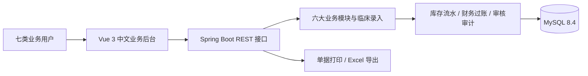

# 药品管理分系统开发设计

设计日期：2026-10-09。版本：需求确认后的第一版设计基线。

## 1. 项目定位与已确认事项

本项目用于课程作业，覆盖药品库房、门诊药房、住院药房、药品会计与价格、制剂、合理用药六大模块，以可演示的完整业务流程作为完成标准。

| 项目 | 已确认内容 |
| --- | --- |
| 组织范围 | 一家医院，多个药库、门诊药房、住院药房和科室 |
| 后端 | Java 21、Spring Boot 3、Maven、MyBatis-Plus |
| 数据库 | 用户的 MySQL 8.4，新建独立数据库 `hlsystem` |
| 前端 | Vue 3、TypeScript、Vite、Element Plus、Pinia、ECharts |
| 运行方式 | 第一版本机运行，前后端分离 |
| 业务数据 | 内置患者、医生、科室、处方、医嘱和简化收费的录入功能 |
| 外部系统 | 无现成 HIS、收费、财务系统；预留接口边界 |
| 角色 | 管理员、药库管理员、门诊药师、住院药师、药品会计、制剂人员、医生 |
| 单据规则 | 草稿、提交、审核、执行；执行才改变库存，纠错通过退药或冲销 |
| 发药规则 | 不允许负库存和发放过期药；优先近效期批次；门诊双人审核发药 |
| 药品单位 | 支持整包装和拆零，统一按最小库存单位核算 |
| 收费 | 门诊缴费后发药；住院维护押金与费用账，欠费由有权限人员处理 |
| 制剂 | 原料采购、质检、生产、半成品和成品、发放销售、成本、凭证、应付付款 |
| 合理用药 | 可维护规则与演示知识，严重问题阻断，普通警告须说明放行原因 |
| 输出 | 浏览器打印、可调整单据模板、手写签字栏、Excel 报表 |
| UI | 中文、浅色、表格与表单为主，主要适配电脑 |
| 交付 | 六大模块全部开发，分阶段完成；无指定截止日期 |

合理用药的知识与剂量规则标记为课程演示数据，验收检查规则运行及审查留痕，不把示例内容当作临床依据。

## 2. 文档导航

| 文档 | 内容 |
| --- | --- |
| [01-requirements.md](01-requirements.md) | 范围、角色权限、功能对照与验收标准 |
| [02-architecture.md](02-architecture.md) | 技术选型、模块边界、前后端目录、安全与部署 |
| [03-workflows.md](03-workflows.md) | 库存、采购调拨、发药、医嘱、结账、制剂、用药审查 |
| [04-database.md](04-database.md) | 数据实体、表与字段、关系、约束、索引、核算规则 |
| [05-ui-design.md](05-ui-design.md) | 导航、视觉规范、主要页面布局、交互和打印 |
| [06-api-contract.md](06-api-contract.md) | 接口规范、状态码、权限、分页、幂等和接口清单 |
| [07-delivery-plan.md](07-delivery-plan.md) | 开发顺序、验收用例、演示数据和质量检查 |
| [08-implementation-status.md](08-implementation-status.md) | 当前可运行代码的覆盖范围和未完成细项 |

建议阅读顺序：需求 → 业务流程 → 架构 → 数据库 → UI → 接口 → 开发安排。

## 3. 总体设计

采用单体应用、业务包划分和本地数据库事务。库存数量、批次成本、处方收费和账务凭证由后端计算与验证。列表、表单和打印在前端完成，汇总报表数据由后端提供。

## 4. 完成标准

1. 六大模块具备录入、审核、执行、查询及对应报表，能够连续演示真实业务链路。
2. 库存变化能追溯到单据、批次、操作者和时间，数量账与金额账可以核对。
3. 角色权限和机构数据范围由后端强制执行。
4. 处方、医嘱、制剂业务有失败提示、撤回或纠错路径，不能依靠直接改库存修正。
5. MySQL 建库升级可重复运行，演示数据单独管理，前端与后端均可独立启动。

## 5. 当前阶段与实施前信息

最初交付为设计文档；用户已授权开始编码和数据库配置。当前代码、SQL 迁移、运行方式和实际完成范围见项目根 README 与 `08-implementation-status.md`，本设计文件保留目标架构。

以下事项到对应开发阶段再获取，不影响当前规划：MySQL 地址、端口、账号与连接权限；数据库是否已存在；本机 JDK、Maven、Node.js 版本；演示医院名称和正式页面名称。数据库连接密码只进入本地环境配置，不写入设计文档或 Git。

设计中的技术补充、成本计算方式和表结构属于工程决策。后续业务调整时同步更新对应文档，并通过版本化迁移变更数据库。
